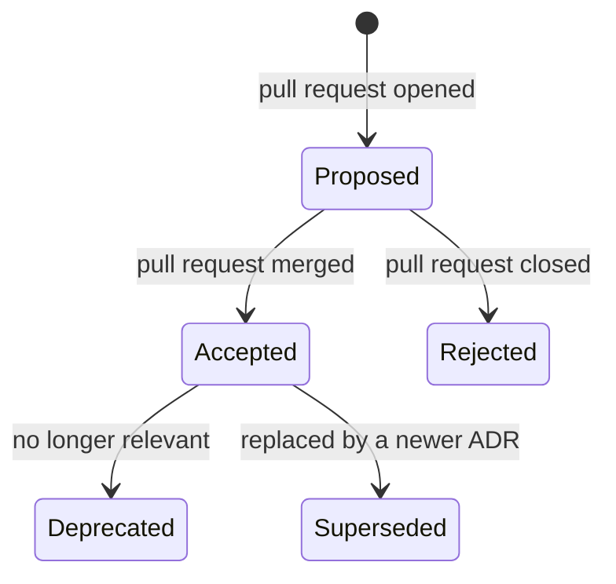

# Architecture Decision Records

This directory records the significant architectural decisions made on CleanShip, together with their context and consequences.

An **Architecture Decision Record (ADR)** is a short, immutable document that explains *why* the system is built the way it is. ADRs help contributors understand trade-offs without having to reverse-engineer them from the code, and help maintainers know *when* a decision may be revisited.

## Index

| ADR | Title | Status |
|---|---|---|
| [0001](0001-record-architecture-decisions.md) | Record architecture decisions | Accepted |
| [0002](0002-rating-single-bounded-context-with-segregated-core.md) | Rating is a single bounded context with a segregated core library | Accepted |
| [0003](0003-application-commands-use-rating-core-model.md) | Application commands use the `rating-core` model | Accepted |

## Lifecycle

## How to propose a new ADR

1. Copy [`template.md`](template.md) to `NNNN-short-title-in-kebab-case.md`, using the next available number.
2. Fill in the context, the decision, the alternatives considered and the consequences. Keep it short: one or two pages.
3. Set the status to **Proposed** and open a pull request. Discussion happens in the pull request.
4. Before merging, set the status to **Accepted** and the date to the merge date, then add the ADR to the index above.

## Rules

- **Accepted ADRs are immutable.** Typos and broken links can be fixed, but the decision itself is never rewritten.
- **To change a decision, write a new ADR** that supersedes the old one, and update the old one's status to `Superseded by ADR-NNNN`.
- **Write an ADR when a decision** is hard to reverse, affects several modules, deviates from a well-known pattern, or is likely to be questioned by a new contributor.
